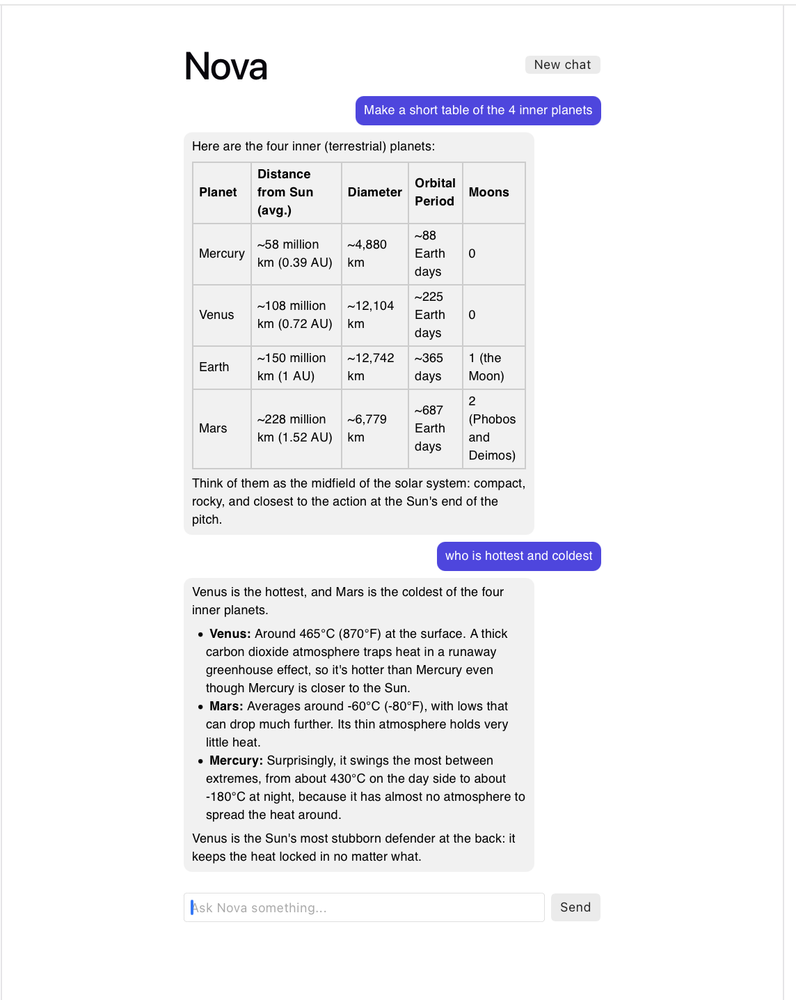

# AI Doc Chat

A full-stack AI chat app built with React, Express, and the Claude API.
Replies stream in live, the conversation keeps its memory, and every request
and response is validated. It's the first stage of a larger project that will
grow into a secure, permission-aware document assistant (RAG).



## Features

- Streaming chat with Claude: replies appear word by word, with full conversation memory
- Express backend that proxies requests, so the API key never reaches the browser
- Request validation with zod: roles, message count, length, last message from the user
- Structured output: a `/api/summarize` endpoint returns validated JSON (title, summary, tags, sentiment)
- Mid-stream error handling: interrupted replies roll back, and cut-off replies are flagged
- Safe error handling: generic messages to users, details only in server logs
- Failed messages roll back to the input box so the user can retry

## Tech stack

- **Frontend:** React, TypeScript, Vite
- **Backend:** Node.js 22, Express, TypeScript (tsx), zod
- **AI:** Claude API (Claude Haiku 5.5, chosen for speed and low cost) via the Vercel AI SDK and the Anthropic SDK

## API

| Method | Route            | What it does                                               |
| ------ | ---------------- | ---------------------------------------------------------- |
| POST   | `/api/chat`      | Streams a reply as NDJSON events (`text`, `error`, `done`) |
| POST   | `/api/summarize` | Returns a structured summary as validated JSON             |

## Getting started

### 1. Install dependencies

```bash
npm install
cd client && npm install
```

### 2. Add your API key

Create a `.env` file in the project root (see `.env.example`):

```
ANTHROPIC_API_KEY=your-key-here
```

### 3. Run the app (two terminals)

```bash
# Terminal 1: backend (http://localhost:3000)
npm run dev

# Terminal 2: frontend (http://localhost:5173)
cd client && npm run dev
```

## Security notes

- The API key lives only in the server's `.env` file, which is excluded from Git
- The frontend talks only to `/api/*` routes on its own origin (Vite proxy), never to the Claude API directly
- The server accepts only `user` and `assistant` roles, which blocks injected `system` messages
- Model output is validated too: structured responses are checked with zod before use
- Stream events are JSON, so model text can't fake an error or "done" signal
- A global error handler returns generic messages, so stack traces and file paths never reach the client
- The `x-powered-by` header is disabled to avoid revealing the framework
- AI output is rendered as plain text (no `dangerouslySetInnerHTML`) to avoid XSS
- Token usage is logged on the server, not exposed to the browser

## What I learned

- The Claude Messages API is stateless: the full history is sent on every turn,
  so input tokens grow with each message (23 → 187 → 438 in my test)
- Never trust input or output: validate requests with zod, and validate the model's JSON too
- Once a stream starts, the HTTP status is already 200, so errors must be sent as events in the stream
- Testing edge cases found a real bug: an empty message array crashed validation and leaked a stack trace
- React state updates are not immediate, so I build the new array before sending it,
  and use functional updates inside the streaming loop
- Fast-moving libraries change often: the editor's type hints flagged deprecated APIs that tutorials still use
- The model refused to quote its system prompt but paraphrased it anyway, so system prompts must be treated as public.

## Roadmap

- [x] Week 1: chat app with memory
- [ ] Week 2: zod validation ✅, structured output ✅, streaming ✅, system prompt ✅, rate limiting, markdown rendering
- [ ] Weeks 3–4: document upload and RAG with pgvector
